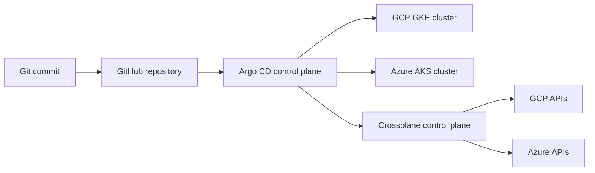

# multicloud-gitops-argocd-crossplane

Reference production baseline for GitOps across GKE and AKS, with Argo CD managing workloads and Crossplane managing cloud infrastructure.

## Architecture



The control plane is expected to run in a management cluster. `argocd/root-app.yaml` bootstraps the ApplicationSet; the ApplicationSet fans the same base workload into registered GKE and AKS clusters.

## Repository layout

* `apps/base` contains the portable workload and service policy.
* `apps/overlays/gcp-gke` and `apps/overlays/azure-aks` provide cluster-specific patches.
* `infrastructure` contains Crossplane providers, XRDs, compositions, and example claims.
* `argocd` contains the App-of-Apps entry point and multi-cluster ApplicationSet.

## GitOps and secrets

Argo CD uses automated sync with `prune: true` and `selfHeal: true`; namespace creation is enabled by sync option. Workload credentials must not be committed. In production, install External Secrets Operator and configure a `ClusterSecretStore` backed by a cloud secret manager; the overlays should reference `ExternalSecret` objects. Sealed Secrets is an acceptable alternative when an offline Git-only workflow is required. Argo CD cluster credentials belong in its own secret-management boundary and are never stored here.

## Bootstrap

Requirements: `kubectl`, `helm`, `kind` (or an existing Kubernetes context), and `argocd` for verification.

```bash
./scripts/bootstrap.sh --context kind-gitops
kubectl -n argocd get pods
kubectl apply -f argocd/root-app.yaml
argocd login localhost:8080 --insecure
argocd app list
```

The script creates a local kind control plane only when `--create-kind` is supplied, installs Argo CD from the official chart, and waits for the server deployment. Register target clusters with `argocd cluster add <context>`; the ApplicationSet expects labels `platform=gke` and `platform=aks` on the Argo CD cluster secrets.

## Infrastructure lifecycle

Install Crossplane and the cloud providers using the platform team's approved credentials, then apply `infrastructure/providers.yaml`, `infrastructure/gcp-gke.yaml`, and `infrastructure/azure-aks.yaml`. Claims are examples and should be reviewed for region, network, identity, and policy requirements before use.

```bash
kubectl apply -f infrastructure/providers.yaml
kubectl apply -f infrastructure/gcp-gke.yaml
kubectl apply -f infrastructure/azure-aks.yaml
kubectl get xclusters,clusters -A
```

## Validation

```bash
kustomize build apps/overlays/gcp-gke | kubectl apply --dry-run=client -f -
kustomize build apps/overlays/azure-aks | kubectl apply --dry-run=client -f -
```

CI runs Kustomize builds and YAML/schema checks on pull requests. Review Crossplane resources with the relevant provider CRDs installed; cloud API validation cannot be performed offline.

## Teardown

```bash
./scripts/destroy.sh --context kind-gitops
```

By default teardown removes only this repository's Argo CD applications. `--delete-kind` additionally deletes the explicitly named local kind cluster. Crossplane claims must be deleted separately and deliberately because cloud deletion is irreversible.

## License

MIT. See [LICENSE](LICENSE).

